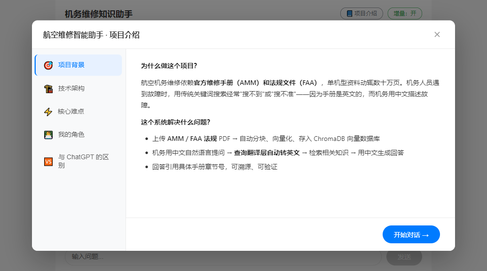
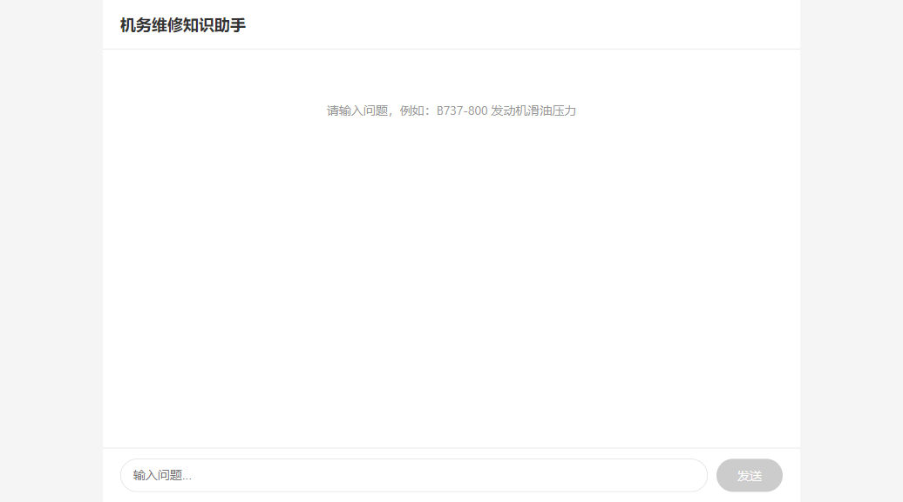
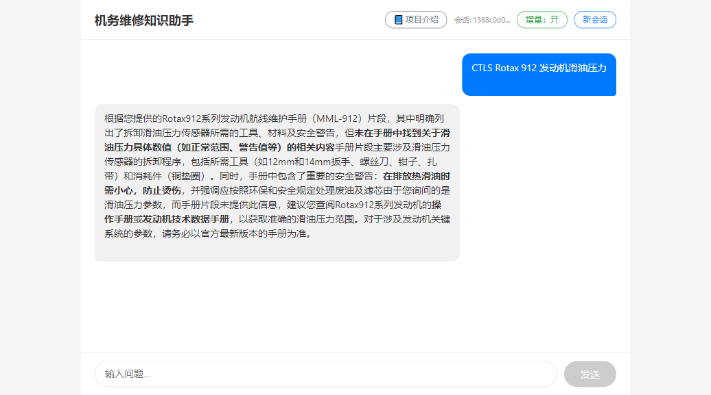
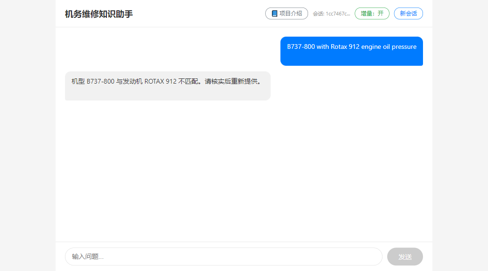
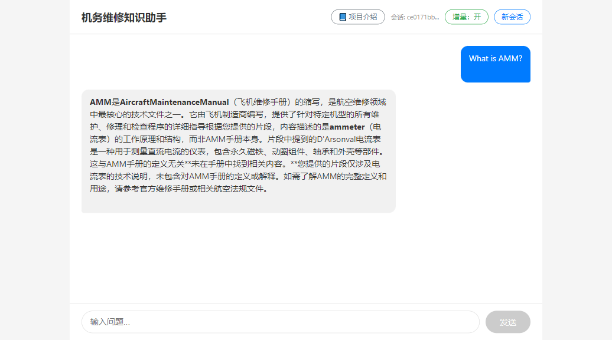
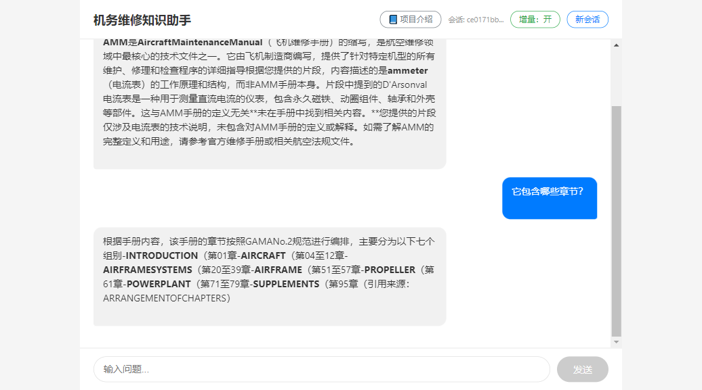
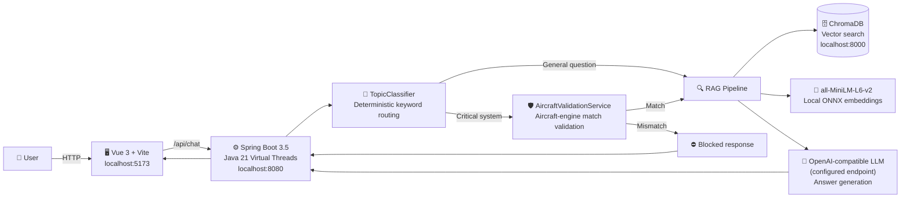

# ✈️ Aviation Maintenance Assistant (AMA)

> A **self-hostable vertical RAG toolkit** for maintenance-manual question answering, with a built-in **aviation maintenance reference implementation**.
> Bring your own documents and OpenAI-compatible endpoint — self-host the application on your own machine or server.

[](https://spring.io/projects/spring-boot)
[](https://adoptium.net/)
[](https://vuejs.org/)
[](https://github.com/langchain4j/langchain4j)
[](docs/CONFIGURATION.md)
[](https://www.trychroma.com/)
[](LICENSE)

**[中文文档 (Chinese README)](README.zh-CN.md)**

---

## What it is / What it is not

**What it is:**

- A **self-hosted RAG toolkit**: you deploy it on your own infrastructure, ingest your own documents, and query them through a chat API or the bundled demo UI.
- An **aviation maintenance reference implementation**: aircraft/engine model validation, deterministic routing for critical systems, and source-cited answers grounded in maintenance manuals.
- An **OpenAI-compatible LLM integration** through LangChain4j with provider-neutral `AMA_LLM_*` configuration and a limited `DEEPSEEK_API_KEY` migration path. See [docs/CONFIGURATION.md](docs/CONFIGURATION.md).

**What it is not:**

- **Not a public hosted Q&A service.** There is no official online demo; you run your own instance.
- **Not a substitute for official manuals (AMM/FIM/IPC).** The system only provides suggestions and source citations. Final maintenance decisions must always be made by qualified engineers against the authoritative manuals.
- **Not a general-purpose chatbot.** It is optimized for grounded, document-cited Q&A over a controlled corpus.
- **Not shipping with any real manuals.** Copyrighted documentation is never included. You bring your own legally obtained documents (see [Data Sources](#data-sources)).

**Planned (target contracts, not yet available):**

- **Read-only MCP server** — expose retrieval and validation as MCP tools. Contract: [docs/MCP.md](docs/MCP.md). Status: **planned**.
- **Golden-set evaluation harness** — reproducible regression evaluation for retrieval and answer quality. Schema: [evals/aviation/golden-set.schema.json](evals/aviation/golden-set.schema.json). Status: **planned**; the item body is not yet authored.
- **Complete persistent traces** — only request-scoped trace IDs and safe logs are currently provided.

---

## 📸 Screenshots

> ⚠️ **Note: the bundled demo UI is currently in Chinese.** An English UI is on the roadmap; the backend API accepts text queries independently of the UI language.

### Project guide mode

A built-in project tour pops up on first visit, explaining the background, architecture, and core design decisions.



### Initial screen

Four quick-start bubbles cover typical scenarios: engine, landing gear, structural repair, and line troubleshooting.



### Scenario 1: Valid aircraft match + RAG retrieval

The user provides an aircraft model and engine model; the system validates the combination, retrieves manual excerpts, and generates an answer with source citations.



### Scenario 2: Aircraft–engine mismatch interception

When the combination does not match, **deterministic code blocks the request** — the LLM is never called, so this validation step is not exposed to LLM hallucination.



### Scenario 3: General knowledge Q&A

Non-critical questions go straight through RAG retrieval, with answers citing manual sources.



### Scenario 4: Multi-turn follow-up (session continuity)

Validated sessions support `conversationId` follow-ups; the aircraft context is injected automatically.



---

## 🚀 Key Features

| Feature | Description |
|---------|-------------|
| 🔍 **RAG retrieval** | Retrieves relevant excerpts from your ingested corpus, then generates answers with source citations |
| 🤖 **Agent-style model validation** | Forces aircraft/engine model validation before answering critical-system questions; mismatches are blocked |
| 🛡️ **Deterministic routing** | Critical systems (engine, flight controls, landing gear, hydraulics) are routed by hard keyword rules — **no LLM self-routing**, no probabilistic errors on control flow |
| 💬 **Session management** | In-memory session store with `conversationId` multi-turn continuity; validated aircraft context auto-injected |
| ⚡ **Java 21 Virtual Threads** | Serves IO-intensive chat workloads on virtual threads, reducing the thread-cost of blocking LLM/DB calls compared to a fixed platform-thread pool |
| 🧠 **Fully local embeddings** | all-MiniLM-L6-v2 ONNX inference (20MB), zero external embedding API calls |
| 🛡️ **Multi-layer rate limiting** | Bucket4j token bucket (default 20 req/hour/IP) plus a global daily LLM quota (default 500 calls/day) |
| 🔄 **Explicit streaming fallback** | Optional one-shot blocking response with visible degradation metadata; no automatic retry after stream failure |
| 🐳 **Docker one-command deployment** | `docker compose up -d` starts frontend + backend + ChromaDB |

> **Data boundary:** local embeddings keep vectorization local, but a cloud LLM still receives questions, validated context, translated queries, and retrieved excerpts. `local-only` rejects non-local endpoints (including link-local) but is not a substitute for firewall or container egress rules.

---

## 🏗️ Architecture



### Request lifecycle (example: "CTLS engine oil pressure")

1. **User input** → `POST /api/chat` → backend receives `ChatRequest`
2. **Routing** → `TopicClassifier` detects the "engine" keyword → critical system
3. **Extraction** → `AircraftInfoExtractor` parses aircraft (CTLS) and engine (Rotax 912) from the query
4. **Validation** → `AircraftValidationService` checks the hardcoded match table → **MATCH**
5. **Session** → generates `conversationId`, stores validation state in `ChatSessionStore`
6. **RAG retrieval** → `TranslationQueryTransformer` optimizes the query → ChromaDB vector search → Top-5 excerpts
7. **LLM generation** → retrieved excerpts are injected into the prompt → the configured OpenAI-compatible LLM generates a cited answer
8. **Response** → `ChatResponse` (reply + conversationId) → frontend rendering

---

## ⚡ Quick Start

### Prerequisites

- [Docker](https://www.docker.com/products/docker-desktop/) (for ChromaDB)
- JDK 21 ([Eclipse Temurin](https://adoptium.net/temurin/releases/?version=21))
- [Node.js 20+](https://nodejs.org/) (frontend development)
- A configured OpenAI-compatible endpoint and, where required, its API key. Generic `AMA_LLM_*` and legacy DeepSeek migration are supported (see [docs/CONFIGURATION.md](docs/CONFIGURATION.md)).

### Option 1: Docker Compose (recommended)

```bash
# 1. Clone the repository
git clone https://github.com/fejerome/aviation-maintenance-assistant.git
cd aviation-maintenance-assistant

# 2. Configure environment variables
cp .env.example .env
# Edit .env and fill in your DEEPSEEK_API_KEY

# 3. Start everything (frontend + backend + ChromaDB)
docker compose up -d
```

Frontend: **http://localhost** — Backend API: **http://localhost:8080/api/chat**

See [DEPLOY.md](DEPLOY.md) for details.

### Option 2: Manual startup (development)

```bash
# 1. Start ChromaDB
docker run -d --name chromadb -p 8000:8000 \
  -v ./backend/chroma-data:/chroma/chroma \
  chromadb/chroma:0.5.5

# 2. Start the backend (⚠️ must run from inside backend/)
cd backend
export DEEPSEEK_API_KEY="sk-xxxxxxxx"
./mvnw spring-boot:run

# 3. Start the frontend
cd ../frontend
npm install
npm run dev
```

Frontend: **http://localhost:5173** — Backend API: **http://localhost:8080/api/chat**

### Ingest your documents

Place your legally obtained PDF manuals into `backend/data/`, then trigger ingestion. The endpoint has no built-in authentication; call it only from localhost or a trusted network, and restrict access at the reverse proxy when deployed:

```bash
curl -X POST http://localhost:8080/api/admin/ingest
```

Try the format-first quickstart corpus in [examples/quickstart/](examples/quickstart/) and the aviation capability notes in [examples/aviation/](examples/aviation/).

---

## 📁 Project Structure

```
.
├── backend/                 # Spring Boot backend
│   ├── src/main/java/.../   # Java sources
│   │   ├── chat/            # Chat API, routing, services, sessions
│   │   ├── document/        # PDF document ingestion
│   │   ├── rag/             # RAG components (query transformer, etc.)
│   │   ├── validation/      # Aircraft model validation
│   │   └── config/          # LLM / ChromaDB configuration
│   ├── data/                # PDF source documents (gitignored — bring your own)
│   ├── chroma-data/         # ChromaDB persistent data (gitignored)
│   └── pom.xml
├── frontend/                # Vue 3 frontend (demo UI, currently Chinese)
│   ├── src/
│   │   ├── App.vue          # Chat main UI
│   │   └── components/      # Chat message components
│   ├── Dockerfile           # Frontend Nginx image
│   ├── nginx.conf           # Frontend Nginx reverse proxy config
│   └── package.json
├── docs/                    # Project documentation
│   ├── API.md               # API reference
│   ├── ARCHITECTURE.md      # Architecture deep-dive
│   ├── CONFIGURATION.md     # BYOK and local-only configuration
│   ├── MCP.md               # Read-only MCP tools (target contract, planned)
│   ├── ADR/                 # Architecture Decision Records
│   └── design/              # Feature design documents
├── examples/                # Quickstart corpus & capability notes
│   ├── quickstart/          # Synthetic sample documents + quickstart guide
│   └── aviation/            # Aviation reference-implementation notes
├── evals/                   # Evaluation assets
│   └── aviation/            # Golden-set schema & evaluation guide (planned)
├── docker-compose.yml       # Docker Compose orchestration
├── DEPLOY.md                # Deployment guide
├── LICENSE                  # MIT License
├── scripts/                 # Test & utility scripts
│   └── tests/               # Manual/semi-automated acceptance scripts
└── README.md                # This file
```

---

## 📚 Data Sources

This repository **does not ship any real manuals**. The aviation reference implementation was developed against **publicly accessible** materials (all rights remain with their respective holders):

| Source | Type | Use |
|--------|------|-----|
| [FAA AC 65-9A](https://www.faa.gov/documentLibrary/media/Advisory_Circular/AC_65-9A.pdf) | US government public textbook | General airframe & powerplant knowledge |
| [Flight Design CTLS AMM](http://flightdesignusa.com/support/resources) | Publicly accessible light-sport aircraft manual | Concrete maintenance procedures |
| [Rotax 912 Line Maintenance](https://brp-rotax.com/) | Engine maintenance manual | Engine system demonstration |

> ⚠️ **Copyright note**: "publicly accessible" does **not** mean "cleared for redistribution". All rights in these documents remain with their respective holders, and the CTLS / Rotax materials are not known to carry an open redistribution license. This repository never distributes real manuals — before ingesting and using any document, you must confirm that you hold the appropriate rights or authorization.
>
> Commercial-aircraft AMMs (e.g. Boeing / Airbus) **must not be publicly distributed**; ingest and use them only when you have the appropriate authorization (for example through your organization's subscription).
>
> **Bring your own documents**: you are responsible for ensuring you have the legal right to ingest and query any document you place in `backend/data/`.

---

## 🗺️ Roadmap

| Item | Status | Notes |
|------|--------|-------|
| Self-hosted RAG toolkit + aviation reference implementation | ✅ Current | This repository |
| BYOK: arbitrary OpenAI-compatible endpoint (base_url / api_key / model) | ✅ Available | [docs/CONFIGURATION.md](docs/CONFIGURATION.md) |
| PDF and Markdown ingestion with stable IDs | ✅ Available | Idempotent document versions |
| Read-only MCP server (`validate_aircraft_model`, `search_manual`, `get_manual_excerpt`) | 📋 Planned | Contract: [docs/MCP.md](docs/MCP.md) |
| Golden-set evaluation harness (~20 aviation items) | 📋 Planned | Schema ready: [evals/aviation/](evals/aviation/); item body not yet authored |
| English demo UI | 📋 Planned | Current UI is Chinese |

---

## 📖 Documentation

- [API Reference](docs/API.md) — request/response examples
- [Architecture](docs/ARCHITECTURE.md) — module responsibilities and data flow
- [Configuration](docs/CONFIGURATION.md) — OpenAI-compatible BYOK, ChromaDB, local-only mode, and rate limiting
- [MCP Tools (target contract, planned)](docs/MCP.md) — read-only MCP interface
- [ADRs](docs/ADR/) — why LangChain4j, ChromaDB, DeepSeek, and the self-hosted pivot
- [Deployment Guide](DEPLOY.md) — Docker Compose deployment & environment variables
- [Contributing](docs/CONTRIBUTING.md) — documentation-driven workflow & commit conventions

---

## 👤 About the Author

Built by an engineer with **three and a half years** of frontline aircraft maintenance experience (Shenzhen Airlines) who later moved into Java backend development — designed by someone who has actually used maintenance manuals on the line, and knows where the real workflow breaks.

Issues and pull requests are welcome.

---

## 📝 License

This project is open-sourced under the [MIT License](LICENSE).
