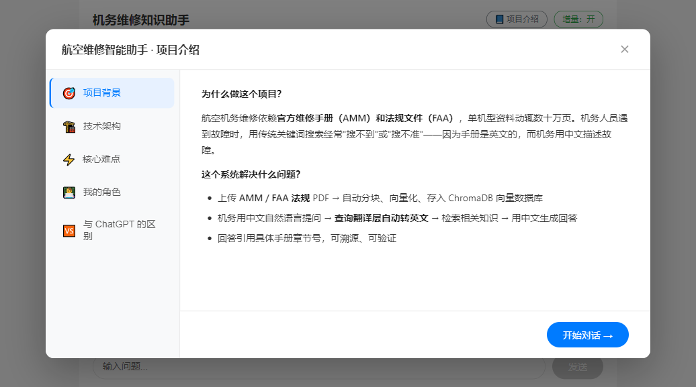
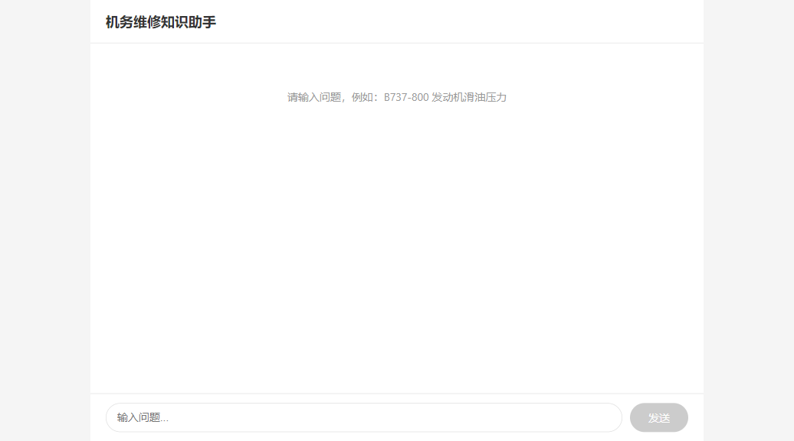
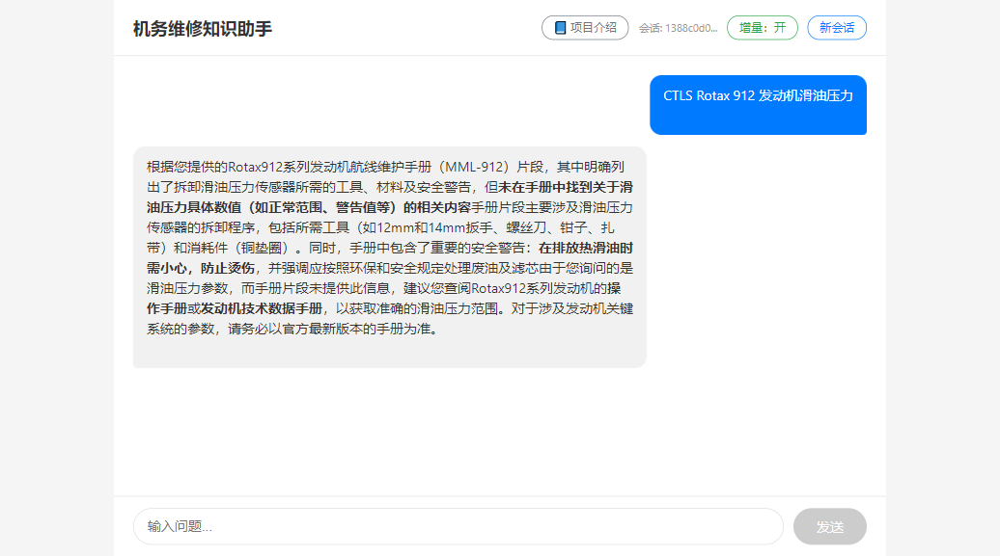
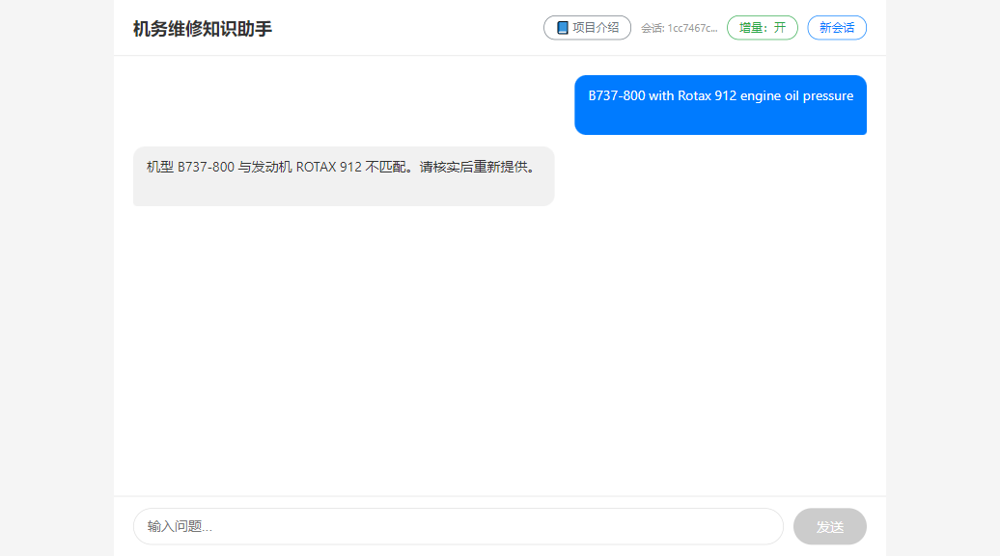
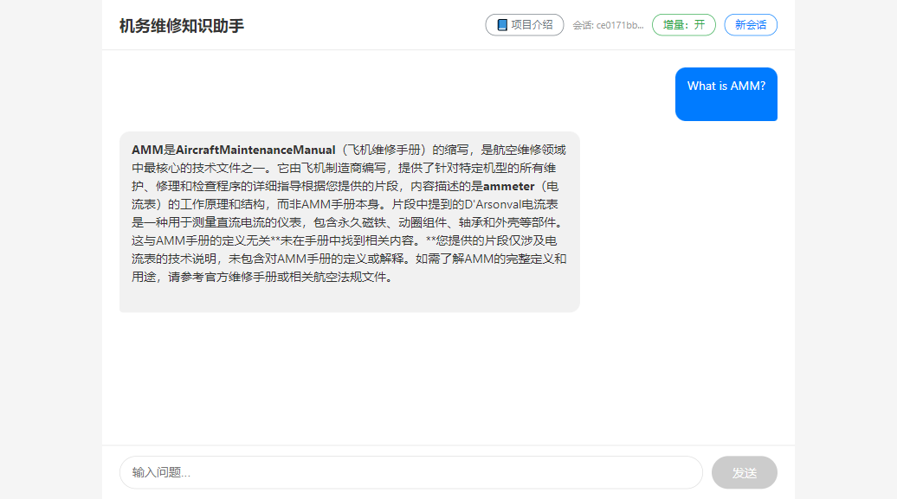
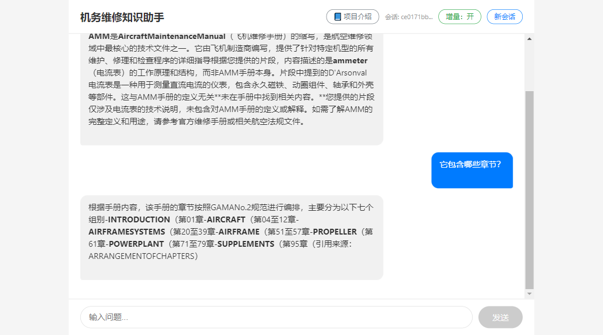
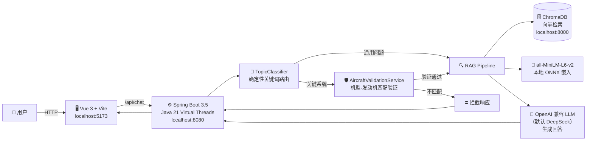

# ✈️ 机务维修知识助手（Aviation Maintenance Assistant）

> 一个**可自托管的垂直领域 RAG 工具包**，内置**机务维修参考实现**。
> 使用自己的文档和 DeepSeek API Key，把应用部署在你自己的机器或服务器上。

[](https://spring.io/projects/spring-boot)
[](https://adoptium.net/)
[](https://vuejs.org/)
[](https://github.com/langchain4j/langchain4j)
[-1E90FF)](docs/CONFIGURATION.md)
[](https://www.trychroma.com/)
[](LICENSE)

**[English README](README.md)**

---

## 它是什么 / 它不是什么

**它是什么：**

- 一个**自托管 RAG 工具包**：部署在你自己的基础设施上，摄入你自己的文档，通过聊天 API 或内置演示界面进行问答。
- 一个**机务维修参考实现**：机型/发动机匹配验证、关键系统确定性路由、基于维修手册的带引用回答。
- 一个 **OpenAI 兼容 LLM 集成**：后端使用 LangChain4j 的 OpenAI 兼容客户端，当前代码**默认使用 DeepSeek**（`deepseek-chat`）。面向任意兼容端点的统一自带密钥（BYOK）配置是**规划中的目标契约**——见 [docs/CONFIGURATION.zh-CN.md](docs/CONFIGURATION.zh-CN.md)。

**它不是什么：**

- **不是公共托管问答服务。** 没有官方在线演示地址，请运行自己的实例。
- **不替代官方手册（AMM/FIM/IPC）。** 系统只提供建议和手册引用，最终维修决策必须由具备资质的工程师依据权威手册做出。
- **不是通用聊天机器人。** 它针对受控语料库上的可追溯、带引用问答做了优化。
- **不附带任何真实手册。** 绝不包含受版权保护的文档。请自带合法获取的文档（见[数据来源](#数据来源)）。

**规划中的能力（目标契约，当前尚不可用）：**

- **只读 MCP 服务**——将检索与验证能力暴露为 MCP 工具。契约见 [docs/MCP.md](docs/MCP.md)。状态：**planned**。
- **Golden-set 评测工具**——可复现的检索与回答质量回归评测。Schema 见 [evals/aviation/golden-set.schema.json](evals/aviation/golden-set.schema.json)。状态：**planned**；评测集本体尚未撰写。
- **Markdown 文档摄入**——当前摄入控制器**仅接受 PDF**；Markdown 端到端摄入为**规划能力**。[examples/quickstart/](examples/quickstart/) 中提供了合成示例，今天就可以预览格式。

---

## 📸 功能演示

> ⚠️ **注意：内置演示界面当前为中文。** 英文界面已在 Roadmap 中；后端 API 不依赖界面语言，可接收英文等文本提问。

### 项目介绍模式

首次进入自动弹出项目导览，帮助新访客快速理解项目背景、技术架构与核心难点。



### 初始界面

空对话状态下，页面中央展示 4 个快捷体验气泡，覆盖发动机、起落架、结构修理、航线排故四类典型场景。



### 场景一：正确机型匹配 + RAG 检索

输入机型与发动机型号，系统自动验证匹配关系，检索维修手册并生成带引用来源的回答。



### 场景二：机型-发动机不匹配拦截

当用户输入不匹配的机型组合时，**确定性代码层直接拦截**，不调用 LLM，使该校验步骤不受 LLM 幻觉影响。



### 场景三：通用知识问答

非关键系统问题直接走 RAG 检索，回答包含手册引用来源。



### 场景四：多轮追问（会话续聊）

已验证会话支持 `conversationId` 续聊，自动注入机型上下文，无需重复提供机型信息。



---

## 🚀 核心特性

| 特性 | 说明 |
|------|------|
| 🔍 **RAG 检索增强** | 从已摄入语料中检索相关片段，生成带引用来源的回答 |
| 🤖 **Agent 机型验证** | 回答关键系统问题前强制校验飞机型号与发动机型号匹配，不匹配即拦截 |
| 🛡️ **确定性路由** | 发动机/飞控/起落架等关键系统走硬性代码路由，**不走 LLM 自路由**，控制流无概率性错误 |
| 💬 **会话管理** | 内存会话存储，支持 `conversationId` 多轮续聊，已验证机型自动注入上下文 |
| ⚡ **Java 21 虚拟线程** | 基于 Virtual Threads 承载 IO 密集型聊天请求，相较固定平台线程池降低 LLM/数据库阻塞调用的线程占用成本 |
| 🧠 **纯本地嵌入模型** | all-MiniLM-L6-v2 本地 ONNX 推理（20MB），零外部 Embedding API 依赖 |
| 🛡️ **多层限流保护** | Bucket4j 令牌桶限流（默认 20 次/小时/IP）+ 全局 LLM 日限额（默认 500 次/天） |
| 🔄 **优雅降级** | LLM 异常时返回固定友好提示，避免前端空白或暴露内部错误 |
| 🐳 **Docker 一键部署** | `docker compose up -d` 启动前端 + 后端 + ChromaDB |

---

## 🏗️ 技术架构



### 请求生命周期（以"CTLS 发动机滑油压力"为例）

1. **用户输入** → `POST /api/chat` → 后端接收 `ChatRequest`
2. **路由分类** → `TopicClassifier` 识别"发动机"关键词 → 判定为关键系统
3. **信息提取** → `AircraftInfoExtractor` 从 query 中提取机型（CTLS）和发动机（Rotax 912）
4. **机型验证** → `AircraftValidationService` 查询硬编码匹配表 → **MATCH**
5. **会话管理** → 生成 `conversationId`，保存验证状态到 `ChatSessionStore`
6. **RAG 检索** → `TranslationQueryTransformer` 优化查询 → ChromaDB 向量检索 → 取 Top-5 片段
7. **LLM 生成** → 将检索片段注入 Prompt → OpenAI 兼容 LLM（默认 DeepSeek）生成带引用的回答
8. **响应返回** → `ChatResponse`（reply + conversationId）→ 前端渲染

---

## ⚡ 快速开始

### 前置条件

- [Docker](https://www.docker.com/products/docker-desktop/)（用于 ChromaDB）
- JDK 21（[Eclipse Temurin](https://adoptium.net/temurin/releases/?version=21)）
- [Node.js 20+](https://nodejs.org/)（前端开发）
- LLM API Key——当前默认配置需要 **DeepSeek** API Key（[获取地址](https://platform.deepseek.com/)）。任意 OpenAI 兼容端点接入是**规划中的目标契约**（见 [docs/CONFIGURATION.zh-CN.md](docs/CONFIGURATION.zh-CN.md)）。

### 方式一：Docker Compose 一键启动（推荐）

```bash
# 1. Clone 仓库
git clone https://github.com/fejerome/aviation-maintenance-assistant.git
cd aviation-maintenance-assistant

# 2. 配置环境变量
cp .env.example .env
# 编辑 .env，填入你的 DEEPSEEK_API_KEY

# 3. 一键启动（前端 + 后端 + ChromaDB）
docker compose up -d
```

访问前端：**http://localhost**　后端 API：**http://localhost:8080/api/chat**

详细部署文档见 [DEPLOY.zh-CN.md](DEPLOY.zh-CN.md)。

### 方式二：手动启动（开发调试）

```bash
# 1. 启动 ChromaDB
docker run -d --name chromadb -p 8000:8000 \
  -v ./backend/chroma-data:/chroma/chroma \
  chromadb/chroma:0.5.5

# 2. 启动后端（⚠️ 必须从 backend/ 目录内启动）
cd backend
export DEEPSEEK_API_KEY="sk-xxxxxxxx"
./mvnw spring-boot:run

# 3. 启动前端
cd ../frontend
npm install
npm run dev
```

访问前端：**http://localhost:5173**　后端 API：**http://localhost:8080/api/chat**

### 摄入你的文档

将合法获取的 PDF 手册放入 `backend/data/`，然后触发摄入。该端点没有内置鉴权；请只从本机或受信网络调用，部署时必须在反向代理层限制访问：

```bash
curl -X POST http://localhost:8080/api/admin/ingest
```

可先体验 [examples/quickstart/](examples/quickstart/) 中的格式示例语料，以及 [examples/aviation/](examples/aviation/) 中的航空能力说明。

---

## 📁 项目结构

```
.
├── backend/                 # Spring Boot 后端
│   ├── src/main/java/.../   # Java 源码
│   │   ├── chat/            # 聊天 API、路由、服务、会话
│   │   ├── document/        # PDF 文档摄入
│   │   ├── rag/             # RAG 组件（查询翻译器等）
│   │   ├── validation/      # 机型验证服务
│   │   └── config/          # LLM / ChromaDB 配置
│   ├── data/                # PDF 源文档（gitignore——请自带文档）
│   ├── chroma-data/         # ChromaDB 持久化数据（gitignore）
│   └── pom.xml
├── frontend/                # Vue 3 前端（演示界面，当前为中文）
│   ├── src/
│   │   ├── App.vue          # 聊天主界面
│   │   └── components/      # 聊天消息组件
│   ├── Dockerfile           # 前端 Nginx 镜像
│   ├── nginx.conf           # 前端 Nginx 反向代理配置
│   └── package.json
├── docs/                    # 项目文档
│   ├── API.md               # 接口文档
│   ├── ARCHITECTURE.md      # 架构说明
│   ├── CONFIGURATION.md     # BYOK 配置（目标契约，planned）
│   ├── MCP.md               # 只读 MCP 工具（目标契约，planned）
│   ├── ADR/                 # 架构决策记录
│   └── design/              # 功能设计文档
├── examples/                # 快速开始语料与能力说明
│   ├── quickstart/          # 合成示例文档 + 快速开始指南
│   └── aviation/            # 航空参考实现说明
├── evals/                   # 评测资产
│   └── aviation/            # Golden-set schema 与评测指南（planned）
├── docker-compose.yml       # Docker Compose 编排
├── DEPLOY.md                # 部署指南
├── LICENSE                  # MIT 许可证
├── scripts/                 # 测试与工具脚本
│   └── tests/               # 手动/半自动验收脚本
└── README.md                # 英文主入口
```

---

## 📚 数据来源

本仓库**不附带任何真实手册**。航空参考实现基于**公开可获取**的资料开发（全部权利仍归各权利人所有）：

| 资料 | 类型 | 用途 |
|------|------|------|
| [FAA AC 65-9A](https://www.faa.gov/documentLibrary/media/Advisory_Circular/AC_65-9A.pdf) | 美国政府公开教材 | 机体与动力装置基础知识 |
| [Flight Design CTLS AMM](http://flightdesignusa.com/support/resources) | 公开可获取的轻型飞机维修手册 | 具体维护程序演示 |
| [Rotax 912 Line Maintenance](https://brp-rotax.com/) | 发动机维护手册 | 发动机系统演示 |

> ⚠️ **版权声明**：「公开可获取」**不等于**「可自由再分发」。这些文档的全部权利归各权利人所有，CTLS 与 Rotax 资料未见开放再分发许可。本仓库绝不分发真实手册——摄入和使用任何文档前，请确认你拥有相应权利或授权。
>
> 商用飞机 AMM（如波音/空客）**不得公开分发**；仅在拥有适当授权（例如所在机构的订阅授权）时摄入使用。
>
> **自带文档**：你有责任确保自己对放入 `backend/data/` 的任何文档拥有合法的摄入与检索权利。

---

## 🗺️ Roadmap

| 事项 | 状态 | 备注 |
|------|------|------|
| 自托管 RAG 工具包 + 机务维修参考实现 | ✅ 当前 | 本仓库 |
| BYOK：任意 OpenAI 兼容端点（base_url / api_key / model） | 🎯 目标契约 | 契约：[docs/CONFIGURATION.zh-CN.md](docs/CONFIGURATION.zh-CN.md) |
| Markdown 文档摄入 | 🎯 目标契约 | 当前：仅 PDF |
| 只读 MCP 服务（`validate_aircraft_model` / `search_manual` / `get_manual_excerpt`） | 📋 Planned | 契约：[docs/MCP.md](docs/MCP.md) |
| Golden-set 评测工具（约 20 条航空条目） | 📋 Planned | Schema 已就绪：[evals/aviation/](evals/aviation/)；条目本体尚未撰写 |
| 英文演示界面 | 📋 Planned | 当前界面为中文 |

---

## 📖 相关文档

- [API 文档](docs/API.md) — 后端接口请求/响应示例
- [架构说明](docs/ARCHITECTURE.md) — 模块职责与数据流详解
- [配置（目标契约，planned）](docs/CONFIGURATION.zh-CN.md) — OpenAI 兼容 BYOK、ChromaDB、限流
- [MCP 工具（目标契约，planned）](docs/MCP.md) — 只读 MCP 接口
- [架构决策记录](docs/ADR/) — 为什么选 LangChain4j、ChromaDB、DeepSeek，以及自托管转型
- [部署指南](DEPLOY.zh-CN.md) — Docker Compose 部署与环境变量说明
- [贡献规范](docs/CONTRIBUTING.md) — 文档驱动开发流程与 Commit 规范

---

## 👤 关于作者

作者拥有**三年半**一线机务维修经验（深圳航空），后转型 Java 后端开发——由真正在航线上用过维修手册的人设计，深知真实工作流程的断点在哪里。

欢迎提交 Issue 和 Pull Request。

---

## 📝 License

本项目基于 [MIT License](LICENSE) 开源。
